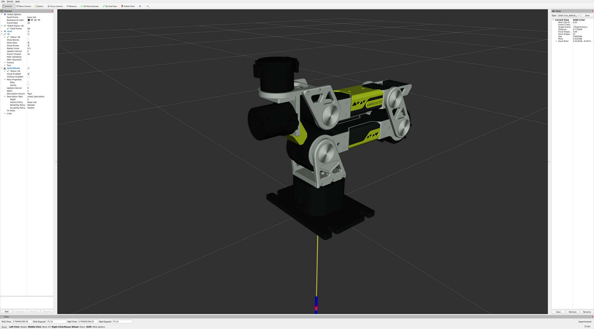
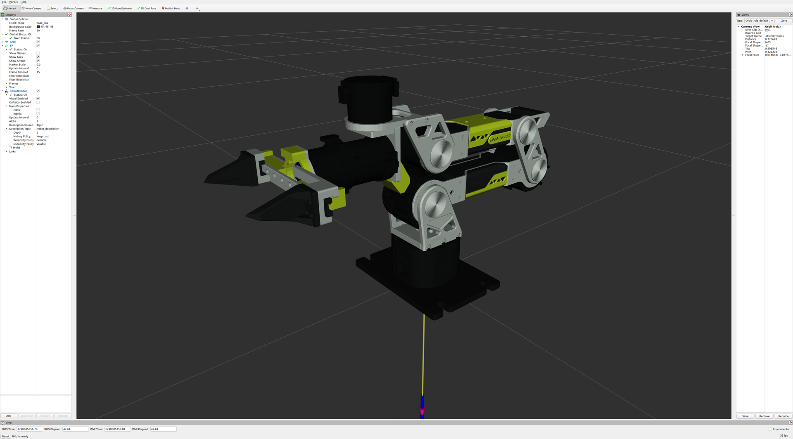
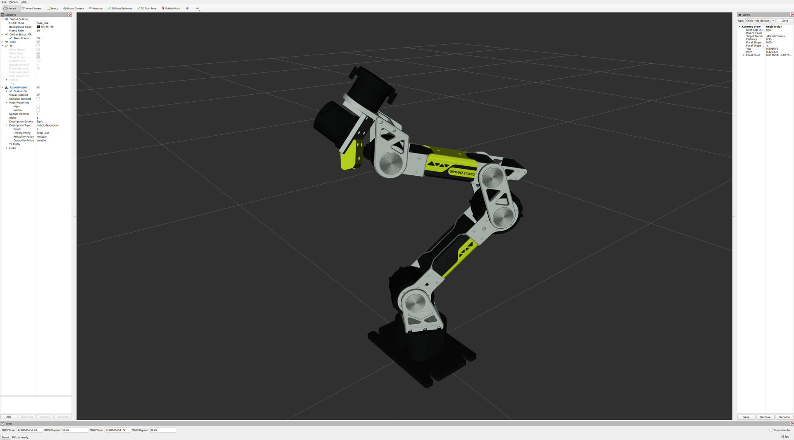
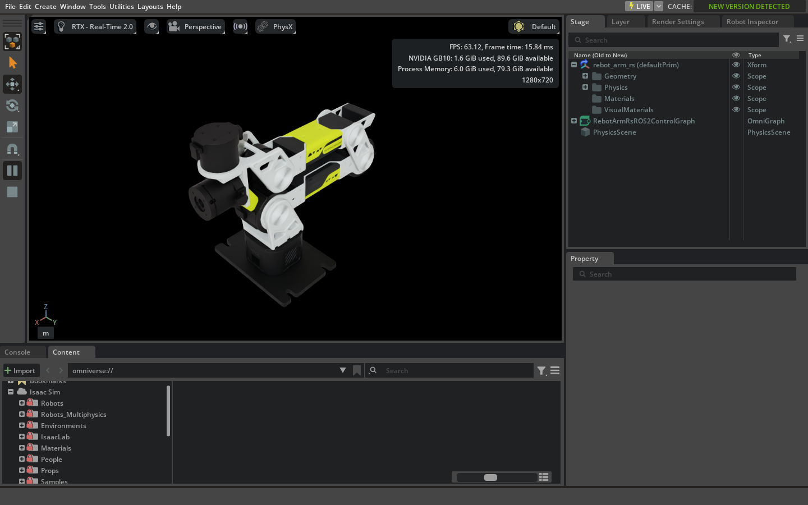
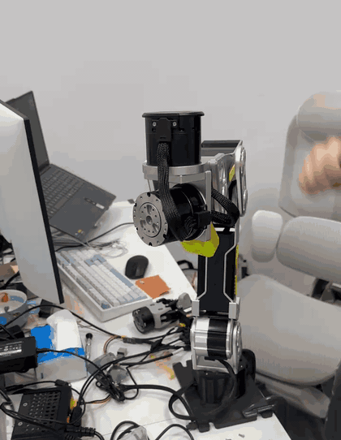
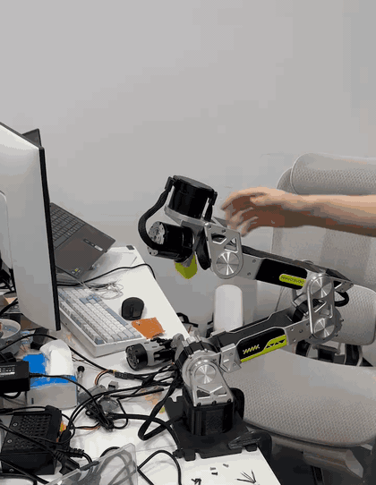
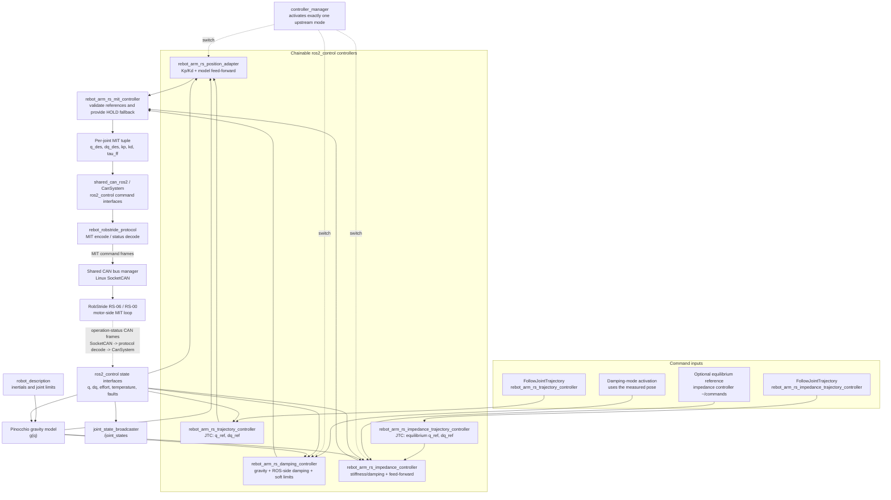

# rebot_arm_rs_ros2

[English](README.md) | [简体中文](README.zh-CN.md)

Native ROS 2 Jazzy control stack for the six-axis Seeed reBot Arm B601-RS.

This project complements Seeed Studio's official
[reBot-DevArm](https://github.com/Seeed-Projects/reBot-DevArm) open-source robot-arm project. The
official repository is the source for hardware designs, BOMs, assembly information, and product
documentation. This repository is an independent ROS 2 integration focused on the B601-RS:
`ros2_control`, RobStride private-CAN communication, controller configuration, robot descriptions,
and simulation launch files.

The driver uses the reusable
[`shared_can_hardware`](https://github.com/xiayip/shared_can_hardware) stack for ros2_control and
SocketCAN, with a RobStride protocol plugin provided by this repository. It does not depend on
MotorBridge at runtime; MotorBridge is retained as an independent protocol oracle during driver
development and hardware validation.

## Highlights

- Native `ros2_control` hardware and standard `JointTrajectoryController` integration.
- MIT position, damping, and impedance controller chains with Pinocchio gravity compensation.
- Conservative startup checks and preload-preserving activation for loaded arms.
- Mock-hardware, RViz, and Isaac Sim launch paths.
- Replaceable flange composition and an optional official Seeed parallel-gripper model.
- Standard `ParallelGripperCommand` action for the optional official gripper.

## Screenshots

| Stock flange (`view_robot.launch.py`) | Official parallel gripper |
| :---: | :---: |
|  |  |
| Mock-hardware JTC trajectory | Isaac Sim stage and ROS 2 control graph |
|  |  |

### Controller demonstrations

Click an animated preview to open the full H.264 video.

| Damping mode | Impedance mode |
| :---: | :---: |
| [](docs/media/damping-mode.mp4) | [](docs/media/impedance-mode.mp4) |
| Gravity-compensated, backdrivable manual guidance | Compliant recovery after an external disturbance |

## Supported target

| Component | Current target |
| --- | --- |
| Robot | reBot Arm B601-RS, six axes |
| Motors | J1-J3 RobStride RS-06; J4-J6 RobStride RS-00 |
| ROS | ROS 2 Jazzy on Ubuntu 24.04 |
| Bus | Linux SocketCAN; launch default is `can1` |
| Simulation | ros2_control mock hardware and Isaac Sim |

Other ROS distributions, motor layouts, and firmware revisions have not been validated by this
repository unless stated otherwise. Review the configured motor IDs, joint limits, zero offsets,
CAN interface, and controller gains before operating a different arm.

The package manifests currently use the pre-release version `0.1.0`; configuration and APIs may
still change before the first tagged stable release.

## Packages

| Package | Purpose |
| --- | --- |
| `rebot_arm_rs` | Aggregate package |
| `rebot_arm_rs_description` | Six-axis URDF/Xacro, optional official parallel gripper, and ros2_control description |
| `rebot_robstride_protocol` | RobStride private-CAN codec plus arm and official-gripper protocol plugins |
| `rebot_arm_rs_bringup` | Controller configuration and launch files |

The six-axis URDF inertial data and aggregate meshes are synchronized from Seeed Studio's official
RS CAD export. See [`UPSTREAM.md`](rebot_arm_rs_description/urdf/UPSTREAM.md) for the pinned
upstream commits, checksums, and the optional-gripper composition policy.

## Description composition

The reusable `rebot_arm_rs` xacro macro describes the six-axis arm core and ends at the stable
`link6` output frame. The stock physical flange is a separate
`rebot_arm_rs_stock_flange` macro containing its own visual, collision, mass, inertia, fixed
attachment, and `tool0` frame. The standalone `rebot_arm_rs.urdf.xacro` composes both macros, so
its default appearance and dynamics include the stock flange.

Robot-specific packages can include only the arm core and attach another flange to `link6`. This
keeps `joint6`, TF names, and ros2_control interfaces stable while allowing the complete physical
flange model to change without adding downstream dependencies to this repository.

An additional `rebot_arm_rs_with_official_parallel_gripper.urdf.xacro` entry point composes the
same arm core with the stock flange and Seeed's official parallel gripper. Preview it with:

```bash
ros2 launch rebot_arm_rs_description view_robot.launch.py \
  description_file:=rebot_arm_rs_with_official_parallel_gripper.urdf.xacro
```

The official model exposes one normalized actuator joint, `gripper_command_joint`, where `0.0` is
fully open and `1.0` is fully closed. Its two published prismatic finger joints mimic that command,
so RViz and TF follow the same normalized state used by ros2_control. The real-hardware description
adds the official RS00 gripper as motor ID `7`; the protocol adapter maps the normalized range to
the official motor endpoints (`5.0 rad` open, `0.0 rad` closed) while reusing the arm driver's MIT
codec, startup checks, feedback and shutdown behavior.

For mock or real arm bringup, select the gripper description explicitly. The gripper controller is
then spawned and activated automatically:

```bash
ros2 launch rebot_arm_rs_bringup mock.launch.py \
  description_file:=rebot_arm_rs_with_official_parallel_gripper.urdf.xacro

ros2 launch rebot_arm_rs_bringup real_world.launch.py \
  description_file:=rebot_arm_rs_with_official_parallel_gripper.urdf.xacro
```

The default remains the arm with stock flange and no gripper, so existing launch behavior and
downstream custom-flange compositions are unchanged. See
[`UPSTREAM.md`](rebot_arm_rs_description/urdf/UPSTREAM.md) for pinned source and license details.

The official gripper uses ros2_controllers'
`parallel_gripper_action_controller/GripperActionController` and exposes the standard ROS 2
`ParallelGripperCommand` action:

```bash
# Fully open the gripper at 25% normalized speed.
ros2 action send_goal \
  /rebot_arm_rs_gripper_controller/gripper_cmd \
  control_msgs/action/ParallelGripperCommand \
  "{command: {name: [gripper_command_joint], position: [0.0], velocity: [0.25]}}"

# Fully close the gripper at 25% normalized speed.
ros2 action send_goal \
  /rebot_arm_rs_gripper_controller/gripper_cmd \
  control_msgs/action/ParallelGripperCommand \
  "{command: {name: [gripper_command_joint], position: [1.0], velocity: [0.25]}}"
```

Velocity is a normalized closing/opening rate in `[0, 1]` per second. The official RS00 adapter
does not expose an effort command because a normalized grasp effort cannot be safely equated to MIT
feed-forward torque without a separately validated force model. Gripper feedback is included in
the regular `/joint_states` stream from `joint_state_broadcaster`; this controller intentionally
does not provide the former `/rebot_arm_rs_gripper/gripper_command` or
`/rebot_arm_rs_gripper/joint_states` compatibility topics. Because no effort command interface is
exported, consumers should treat the upstream Jazzy controller's action-result `state.effort` field
as unspecified and use `reached_goal`, `stalled`, and the position/velocity feedback instead.

## Repository dependencies

The source is intentionally split into three repositories with one-way dependencies:

```text
rebot_arm_rs_ros2
├── zephyr_controllers       (MIT controller stack)
└── shared_can_hardware      (shared CAN ABI, bus manager and SocketCAN transport)
```

[`zephyr_controllers`](https://github.com/xiayip/zephyr_controllers) and
[`shared_can_hardware`](https://github.com/xiayip/shared_can_hardware) do not depend on this
repository or on each other. They communicate through standard ros2_control command/state
interfaces, so either lower layer can be reused by another robot or hardware implementation.

This repository owns only the reBot-specific integration:

- `rebot_arm_rs_description`: robot model and ros2_control hardware description.
- `rebot_robstride_protocol`: the RobStride protocol plugin for `shared_can_interface`.
- `rebot_arm_rs_bringup`: controller instances, calibrated gains, gravity/friction parameters and
  launch files.

The `rebot_arm_rs` aggregate package declares the exact MIT controller subset it needs instead of
depending on the full `zephyr_controllers` meta-package. This avoids installing unrelated base,
hand, gripper and diagnostic controllers.

For a source workspace, clone this repository first and import its two project dependencies:

```bash
mkdir -p ~/rebot_ws/src
cd ~/rebot_ws/src
git clone https://github.com/xiayip/rebot_arm_rs_ros2.git
cd ~/rebot_ws
vcs import src < src/rebot_arm_rs_ros2/rebot_arm_rs_jazzy.repos
```

[`rebot_arm_rs_jazzy.repos`](rebot_arm_rs_jazzy.repos) records the dependency repository URLs and
currently follows their active `main` branches. Release snapshots should replace those branch
names with compatible immutable tags or commit hashes.

## Safety before real-hardware use

This software can command enough torque to move the arm suddenly. Before the first real-hardware
launch:

1. Support the complete arm and payload, keep people and cables outside the swept volume, and keep
   a power disconnect within reach.
2. Verify joint zero offsets, motor IDs, joint directions, limits, payload description, and the CAN
   interface against the physical robot.
3. Stop MotorBridge, CAN test scripts, and any other process that can transmit on the same bus.
   Only one control owner may use the arm CAN bus.
4. Start with conservative trajectories and confirm every joint is enabled and holding before
   removing support.

A normal Ctrl-C intentionally does **not** send motor-disable frames; the motor-side command remains
active so the arm does not immediately lose holding torque. Do not mistake process exit for a safe
power-off state. Power loss, a motor fault, or a separately configured CAN timeout can still remove
torque. Use independent mechanical support whenever loss of holding torque could cause damage.

## Controller architecture

The real-hardware stack uses chainable controllers rather than sending trajectories directly to
the motor protocol:



The three upstream branches are mutually exclusive; the MIT output controller remains active as
their common final stage. It validates and writes one complete command tuple per joint. The motor
firmware then evaluates the MIT law
`tau = kp * (q_des - q) + kd * (dq_des - dq) + tau_ff`. Position and impedance modes place their
configured gains in the motor-side `kp`/`kd` fields. Damping mode instead computes damping torque
from measured velocity in the ROS realtime loop and carries it in `tau_ff`, together with gravity
and soft-limit torque.

| Mode | Active high-level controllers | Intended use |
| --- | --- | --- |
| Position trajectory | `rebot_arm_rs_trajectory_controller` + `rebot_arm_rs_position_adapter` | Default, stiff trajectory tracking through MIT commands |
| Damping | `rebot_arm_rs_damping_controller` | Backdrivable, gravity-compensated manual guidance |
| Impedance trajectory | `rebot_arm_rs_impedance_trajectory_controller` + `rebot_arm_rs_impedance_controller` | Compliant trajectory tracking and obstruction handling |
| MIT output | `rebot_arm_rs_mit_controller` | Final chained output stage; normally kept active under all three modes |

The position trajectory mode is an MIT position-control chain, not the motors' native CSP loop.
The calibrated gains and feed-forward values in `controllers.yaml` are robot-specific starting
points; revalidate them after changing the flange, tool, payload, mounting orientation, or motor
firmware.

## Hardware startup behavior

- The generic hardware plugin opens the CAN bus once and reads each motor's position, `run_mode`,
  and filtered phase current during activation.
- The startup position command preserves the existing load preload. The driver reads filtered
  phase current (`iqf`), converts peak current to output torque with the model torque constant, and
  applies the bounded offset `torque / mit_kp` to the measured position. This prevents resetting a
  loaded impedance hold to zero torque when ros2_control starts.
- Activation always enables the arm. The driver first sends the preload-preserving MIT hold as a
  probe: motors already in Motor mode are not enabled again, while stopped motors receive adjacent
  enable and hold frames. Motors already in MIT `run_mode` are not reconfigured.
- For motors already in MIT mode, the updated shared CAN runtime repeats no-enable probes
  approximately every 20 ms, with a 3 s timeout. A disabled motor needs at least three fault-free
  status replies spanning 30 ms, with position span <= 0.003 rad, temperature span <= 1 C,
  absolute velocity <= 0.5 rad/s, and latest feedback no older than 100 ms. Moving more than
  0.025 rad from the initial supported pose prevents activation until it is retried. Before
  enabling, the stopped motor's hold and exported command baseline are reseeded to its latest
  measured pose. A warm MIT motor keeps its preload hold and needs fresh fault-free Motor-mode
  feedback, not a redundant enable or cold settling delay.
- This is a conservative guard for the observed RS firmware startup race, **not a documented
  firmware-ready bit or a torque self-test**. Initial status at exactly 0 C was observed before
  a working temperature/status update. Such feedback is ambiguous and does not pass the gate;
  no automatic disable/re-enable is attempted. Real near/below-zero-temperature operation needs
  separate validation, not simply bypassing this check. Non-MIT mode conversion retains the
  existing sequence and is not covered by this MIT-only readiness validation.
- Build both `shared_can_ros2` and `rebot_robstride_protocol` for this guard. A readiness timeout
  reports the affected joint/reason and fails before sending enable/disable frames. Keep the
  complete arm supported during cold activation; these checks cannot establish payload support.
- The trajectory controller is spawned as the head of a three-controller chain by default:
  `JointTrajectoryController -> MIT position adapter -> MIT output controller`. Pass
  `activate_trajectory_controller:=false` to keep the MIT output controller active in safe HOLD
  while loading the trajectory controller and position adapter as inactive.
- Each joint exports the complete MIT command tuple as `position`, `velocity`, `kp`, `kd`, and
  `t_ff`. The MIT output controller exclusively claims that tuple and exposes chainable reference
  interfaces. The position adapter completes each JTC position reference with the configured
  position-mode gains, the JTC velocity reference, and an optional Pinocchio gravity
  feed-forward torque.
  The per-joint `position_kp` and `position_kd` arrays are runtime-adjustable and are transferred
  into the realtime loop without requiring controller restart.
  The default real-hardware configuration applies the commissioned affine gravity calibration for
  joints 2-4 at `gravity_compensation.factor=1.0`; the remaining joint scales are zero.
- The gravity model is built from the same `robot_description` used by ros2_control. Controller
  activation preserves the previous MIT tuple's equivalent torque, then rate-limits and blends the
  command into `g(q)` instead of stepping the feed-forward command. The runtime factor is limited
  to `[0, 1]` and follows changes over the configured `factor_transition_duration`.
- The position adapter publishes `~/mit_state` as `control_msgs/msg/DynamicJointState` at the
  configured rate. For every joint it reports the position and velocity references, raw and
  scaled gravity torque, runtime gravity factor, applied feed-forward torque, P and D feedback
  torques, and their summed MIT command torque.
- The joint impedance controller sends its stiffness and damping through the motor-side MIT
  `kp`/`kd` loop. The ROS realtime loop supplies calibrated gravity and URDF soft-limit torque
  through shaped `t_ff`, captures the current posture as the activation equilibrium, and accepts
  rate-limited references from a dedicated impedance JTC. Per-joint spring torque limits bound
  `kp * (q_ref - q)` by reducing the motor equilibrium error without moving feedback back into the
  ROS loop. The standalone `~/commands` topic remains available while the impedance controller is
  not chained to its JTC.
- The impedance trajectory guard monitors tracking error and measured velocity. If any joint stays
  beyond its configured error threshold while approximately stationary for the configured blocking
  duration, it cancels the active impedance JTC goal. JTC cancellation captures the measured
  posture as a zero-velocity hold. Its wider path tolerances remain a second-level fallback for
  larger tracking errors.
- Runtime feedback has one source: every operation-status response updates position, velocity,
  effort, temperature, and fault state at the control rate. `0x7019` is read once during activation
  only to establish the safe initial hold position; it is not polled and cannot overwrite runtime
  state. Parameter reads remain available to separate diagnostic tools.
- All MIT commands are clamped to the model-specific limits. Position is additionally constrained
  to the joint limits and to a configurable maximum step.
- J1-J3 are configured as RS-06, J4-J6 as RS-00, all with host ID `0xFD`.
- On a normal Ctrl-C shutdown the driver never sends motor-disable frames, so each motor keeps
  executing its last MIT position command and holds the arm instead of immediately losing torque.
  Holding still depends on uninterrupted motor power and the motor-side CAN timeout configuration;
  a process cannot guarantee holding after a power loss or an independently configured
  communication-timeout shutdown.

MotorBridge Gateway and this hardware plugin must not control the same CAN bus at the same time.

## Build and first mock launch

```bash
source /opt/ros/jazzy/setup.bash
cd ~/rebot_ws
vcs import src < src/rebot_arm_rs_ros2/rebot_arm_rs_jazzy.repos
rosdep install --from-paths src --ignore-src --rosdistro jazzy -r -y
colcon build --symlink-install --packages-up-to rebot_arm_rs
source install/setup.bash

# No physical hardware: validate the description and controller stack in RViz.
ros2 launch rebot_arm_rs_bringup mock.launch.py
```

Run `colcon` from the ROS 2 workspace root rather than from one of its parent directories; this
prevents package discovery from scanning unrelated Python sources.

## Launch and operate

### Description and simulation

```bash
# Inspect the stock robot description without ros2_control.
ros2 launch rebot_arm_rs_description view_robot.launch.py

# Open the checked-in robot asset and start its Isaac ros2_control backend.
ros2 launch rebot_arm_rs_bringup isaac_sim.launch.py

# The same asset can be started without a GUI for launch and bridge validation.
ros2 launch rebot_arm_rs_bringup isaac_sim.launch.py headless:=true
```

The Isaac launch starts a simulation-specific position trajectory controller and
`topic_based_ros2_control/TopicBasedSystem`; the physical MIT controller chain is unchanged. At
runtime it creates an Action Graph that publishes `/rebot_arm_rs/isaac_joint_states`, subscribes
to `/rebot_arm_rs/isaac_joint_commands`, drives the articulation, and publishes `/clock`. Pass
`start_ros2_control:=false` to open only the Isaac stage and Graph. See
[`rebot_arm_rs_description/usd/README.md`](rebot_arm_rs_description/usd/README.md) for the explicit
URDF-to-USD regeneration workflow.

Send a simulation trajectory with:

```bash
ros2 action send_goal \
  /rebot_arm_rs_isaac_trajectory_controller/follow_joint_trajectory \
  control_msgs/action/FollowJointTrajectory \
  "{trajectory: {joint_names: [joint1, joint2, joint3, joint4, joint5, joint6], \
  points: [{positions: [0.1, 0.2, 0.2, 0.0, 0.0, 0.0], \
  time_from_start: {sec: 3}}]}}"
```

### Real hardware

Complete the safety checks above, configure and bring up the SocketCAN interface, then launch:

```bash
# Physical CAN bus; stopped motors enable, and Ctrl-C retains the last motor-side hold command.
ros2 launch rebot_arm_rs_bringup real_world.launch.py can_interface:=can1

# Optional startup with the trajectory controller loaded but inactive.
# The hardware driver still enables and holds the arm.
ros2 launch rebot_arm_rs_bringup real_world.launch.py \
  can_interface:=can1 activate_trajectory_controller:=false
```

Check state before commanding motion:

```bash
ros2 control list_controllers -c /controller_manager
ros2 topic echo --once /joint_states
```

Send a small position trajectory only after confirming that the physical direction and workspace
are safe:

```bash
ros2 action send_goal \
  /rebot_arm_rs_trajectory_controller/follow_joint_trajectory \
  control_msgs/action/FollowJointTrajectory \
  "{trajectory: {joint_names: [joint1], points: [{positions: [0.1], \
  time_from_start: {sec: 3, nanosec: 0}}]}}"
```

### Switch control modes

`--strict` rejects a request that tries to deactivate a controller that is not active. Run
`ros2 control list_controllers` first and include only the currently active source controllers.

From the default position trajectory chain to damping mode:

```bash
ros2 control switch_controllers \
  --deactivate rebot_arm_rs_trajectory_controller rebot_arm_rs_position_adapter \
  --activate rebot_arm_rs_damping_controller \
  --strict -c /controller_manager
```

From damping mode back to the default position trajectory chain:

```bash
ros2 control switch_controllers \
  --deactivate rebot_arm_rs_damping_controller \
  --activate rebot_arm_rs_position_adapter rebot_arm_rs_trajectory_controller \
  --strict -c /controller_manager
```

From the default position trajectory chain to the compliant impedance trajectory chain:

```bash
ros2 control switch_controllers \
  --deactivate rebot_arm_rs_trajectory_controller rebot_arm_rs_position_adapter \
  --activate rebot_arm_rs_impedance_controller \
             rebot_arm_rs_impedance_trajectory_controller \
  --strict -c /controller_manager
```

Send a trajectory through the impedance JTC:

```bash
ros2 action send_goal \
  /rebot_arm_rs_impedance_trajectory_controller/follow_joint_trajectory \
  control_msgs/action/FollowJointTrajectory \
  "{trajectory: {joint_names: [joint2], points: [{positions: [0.3], \
  time_from_start: {sec: 3, nanosec: 0}}]}}"
```

Return to the default position trajectory chain:

```bash
ros2 control switch_controllers \
  --deactivate rebot_arm_rs_impedance_trajectory_controller \
               rebot_arm_rs_impedance_controller \
  --activate rebot_arm_rs_position_adapter rebot_arm_rs_trajectory_controller \
  --strict -c /controller_manager
```

### Diagnostics and runtime tuning

```bash
# Inspect the realtime MIT command decomposition.
ros2 topic echo /rebot_arm_rs_position_adapter/mit_state

# Inspect the desired/limited impedance equilibrium, MIT gains, and torque decomposition.
ros2 topic echo /rebot_arm_rs_impedance_controller/state

# Tune the position-mode gains online. Each array must contain one nonnegative value per joint.
# Do this only with the arm supported and after recording the current values.
ros2 param set /rebot_arm_rs_position_adapter \
  position_kp "[300.0, 300.0, 300.0, 80.0, 80.0, 80.0]"
ros2 param set /rebot_arm_rs_position_adapter \
  position_kd "[6.0, 12.0, 12.0, 5.0, 4.0, 4.0]"
```

## Source references

- reBot Arm main hardware, BOM, and community repository:
  [Seeed-Projects/reBot-DevArm](https://github.com/Seeed-Projects/reBot-DevArm)
- Seeed B601-RS URDF kinematics and arm meshes:
  [Seeed-Projects/reBotArmController_ROS2](https://github.com/Seeed-Projects/reBotArmController_ROS2)
- Seeed official parallel-gripper URDF and meshes:
  [Seeed-Projects/reBot-DevArm](https://github.com/Seeed-Projects/reBot-DevArm)
- RobStride private CAN protocol behavior: RobStride manuals and MotorBridge 0.5.1

Exact imported revisions and asset checksums are recorded in
[`rebot_arm_rs_description/urdf/UPSTREAM.md`](rebot_arm_rs_description/urdf/UPSTREAM.md).

## License

The ROS integration packages declare `Apache-2.0` in their package manifests. Imported Seeed
hardware-description assets retain their upstream licensing and provenance. In particular, the
official parallel-gripper hardware assets are covered by `CERN-OHL-W-2.0`; see
[`rebot_arm_rs_description/LICENSES`](rebot_arm_rs_description/LICENSES) and
[`UPSTREAM.md`](rebot_arm_rs_description/urdf/UPSTREAM.md) before redistributing modified assets.

## Contributing

Issues and pull requests are welcome. Keep robot-specific protocol and description changes in this
repository, reusable CAN transport changes in
[`shared_can_hardware`](https://github.com/xiayip/shared_can_hardware), and generic controller
changes in [`zephyr_controllers`](https://github.com/xiayip/zephyr_controllers). For code changes,
build the affected packages and run:

```bash
colcon test --packages-up-to rebot_arm_rs
colcon test-result --verbose
```

Hardware changes should include the tested arm configuration, firmware version, CAN capture or
relevant controller telemetry, exact commands, and whether the result was obtained on mock,
simulation, or physical hardware. Never report an unexecuted hardware test as successful.

## HMI controller switching in MONITOR

The optional `rebot_arm_hmi_bridge` package connects HMI firmware 0.31.0's
`MONITOR → ROS MODE` menu to controller_manager. It supports the existing
position trajectory, damping and impedance trajectory chains. A request uses
STRICT switching and reports success only after a fresh controller-list query
confirms the target chain. The base MIT controller, joint-state broadcaster and
gripper are preserved. It does not send motor commands or change joint gains.

```bash
source /opt/ros/jazzy/setup.bash
colcon build --packages-select rebot_arm_hmi_bridge --symlink-install
source install/setup.bash
ros2 run rebot_arm_hmi_bridge hmi_bridge --ros-args \
  -p can_interface:=can0 -p controller_manager:=/controller_manager \
  -p controller_namespace:=/
```

Only one bridge may run on a bus. The CAN interface must already be configured
at 1 Mbit/s and accessible to the node, with the same ROS domain as the manager.
Start the existing arm stack first; one complete supported chain and the base
MIT controller must be active, and target controllers must be configured.

Active FollowJointTrajectory goals are rejected without cancellation. Fresh,
stationary JTC telemetry is also required. Direct `joint_trajectory` publishers
block switching because their complete trajectory lifecycle cannot be queried;
use the action interface and stop direct topic publishers. Other ROS clients
must serialize new goals and switch requests with HMI switching: preflight and
switch_controller are not an atomic cross-client transaction.

Requests carry single-use 32-bit tokens; duplicates return cached results.
Timeouts do not trigger retries, cancellation or rollback. Unresolved timed-out
services quarantine further switching until their outcome is queried. The
bridge's 200 ms heartbeat prevents entry into HMI's local MASTER/TEACH idle gate;
stop the bridge and PC motor command stream before using those local modes.

See [Chinese deployment and test instructions](README.zh-CN.md#hmi-monitor--ros-mode-控制器切换)
and the canonical [HMI CAN protocol specification](https://jihulab.com/robot_group/zephyr_embedding/arm_hmi_node/-/blob/main/README.md#ros-mode-主站通信协议-v1)
for frame layouts (standard IDs 0x6F0–0x6F2), result codes, timing, limitations and
read-only diagnostics. Physical switching tests are pending firmware deployment.
